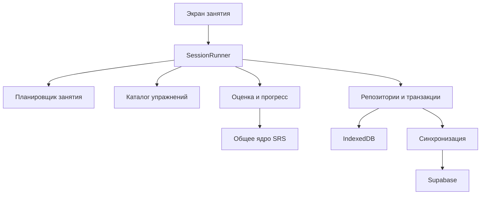

# Архитектура тренажёра v2: словарь и общие механики

> **Current policy — 2026-10-30:** V1 is retired. Any requirement below to keep
> its client/API working, defer retirement to R3 or verify v1 before releasing v2
> is superseded by [v1-retirement.md](v1-retirement.md) and [AGENTS.md](../AGENTS.md).
> Auth/accounts and historical rows stay; v1 compatibility and parallel operation
> are not release requirements. Run `disable-v1.sql` on the existing project.

Статус: проект решения для реализации. Область: слова, их колоды, занятия,
компонентный прогресс и синхронизация. Новая версия полностью заменяет старую.
Первый этап реализации — словарный тренажёр. До замены сайта обязательно
переносятся все существующие типы упражнений; старые URL/API и код сохранять
не требуется. Сохраняем пользовательские возможности, перерабатывая реализацию.

Основание: обсуждение требований и ревью main `c83173b`.
Этот документ не означает, что новая архитектура уже реализована.

## 1. Требования и основные решения

1. Прогресс принадлежит пользователю и слову, а не странице, упражнению или колоде.
2. У прогресса несколько компонентов памяти с независимыми сроками SRS.
3. Упражнение создаёт свидетельства о компонентах, но само не меняет хранилище/SRS.
4. «Учить новые» и «Повторить созревшие» — разные стратегии отбора слов.
5. Доступны фиксированный набор до 20 слов для одного упражнения и набор
   до 5 слов для последовательного прохождения упражнений.
6. Полный круг упражнений остаётся доступным; адаптивный круг созревших
   компонентов не заменяет его.
7. Недостающие созревшие слова не дополняются новыми автоматически.
8. Переключение колоды/упражнения не создаёт новый независимый прогресс слова.
9. Ответы сохраняются сразу и не теряются при закрытии страницы или отсутствии сети.
10. Показ ответа и несколько близких повторов не равны нескольким независимым
    успешным повторениям. Это правило едино для всех упражнений.
11. Добавленные пользователями слова пополняют общедоступный каталог.
    Личным остаётся прогресс пользователя; новая отдельная база private-слов
    не является основным сценарием.
12. При первом добавлении кандидата перевод и примеры запрашиваются из
    публичных источников. Повторное добавление использует общий каталог/кеш.
13. Пользователь отдельно проверяет значение слова, переводы и каждый
    включаемый пример с его переводом. Импорт не равен подтверждению качества.
14. Подробный контракт общего каталога, загрузки и проверки зафиксирован в
    [shared-vocabulary-catalog.ru.md](shared-vocabulary-catalog.ru.md).
15. V2 подготавливается в существующем Supabase-проекте без новой базы.
    Аккаунты/Auth сохраняются; старые таблицы и RPC работают до релизного отключения.
    Прогресс v2 начинается отдельно, без импорта старых SRS-снимков.
16. Старую версию можно заменить целиком: её маршруты, DOM, форматы контента,
    код не являются контрактом новой реализации. Существующие пользовательские
    возможности сохраняются и проверяются по матрице функциональной полноты.

## 2. Слои и зависимости



Domain-ядро — чистые функции и типы, без DOM, localStorage, Supabase, TTS,
чтения текущего пользователя и прямых вызовов Date.now(). Время и настройки
передаются аргументами. UI не импортируется из доменных модулей.

Приложение остаётся статическим TypeScript-приложением. Внедрение React или
другого UI-фреймворка для этой архитектуры не требуется.

| Модуль | Ответственность |
| --- | --- |
| WordCatalog | Слова, допустимые ответы, стабильные ID и принадлежность колодам |
| EnrichmentService / ContributionService | Первичная загрузка кандидатов, проверка и публикация общего контента |
| ExerciseRegistry | Создание заданий, проверка ответа, указание проверяемых компонентов |
| SessionPlanner | Отбор слов и построение фиксированного плана |
| SessionRunner | Переходы, команды, сохранение, возобновление занятия |
| EvidencePolicy | Превращение результата задания в наблюдения о памяти |
| ProgressProjector | Построение единого прогресса слова по наблюдениям |
| Scheduler | SRS-переходы и оценка вероятности воспроизведения |
| ProgressQueries | Созревшие слова, новые слова, сводка для главной |
| LocalRepository / SyncService | Атомарная локальная запись и обмен событиями |

## 3. Слово, колода и набор занятия

Три разные сущности:

- **Word** — учебная единица: лексема/часть речи/значение с постоянным wordId.
- **Deck** — именованный набор ссылок на wordId: A2, Beruf, Architecture и т. п.
- **StudyBatch** — зафиксированный набор из 5 или 20 wordId на конкретное занятие.

Одно слово может принадлежать нескольким Deck. StudyBatch хранится в плане
занятия, но не создаёт новые слова и не содержит собственной копии прогресса.
Slug, перевод, позиция в JSON и ID старой колоды не служат глобальной идентичностью.

```ts
type WordId = string;
type Component = 'recognition' | 'recall' | 'spelling' | 'article';

interface Word {
  id: WordId;
  lemma: string;
  partOfSpeech: string;
  senseId: string;
  article?: 'der' | 'die' | 'das';
  meanings: Record<string, { preferred: string; accepted: string[] }>;
  acceptedGermanForms: string[];
  examples: { de: string; translations: Record<string, string> }[];
  tags: string[];
  contentVersion: number;
}

interface Deck {
  id: string;
  title: string;
  wordIds: WordId[];
}
```

`Word` выше — опубликованная модель чтения для упражнений. Исходные кандидаты,
источники, подтверждения конкретных ревизий и журнал изменений хранятся
отдельно. Упражнения получают только опубликованные элементы, подходящие
для языка задания; непроверенные варианты не становятся допустимыми ответами.

Дедупликация требует явной таблицы соответствий: совпадение немецкой строки
не доказывает одинаковое значение. `der Band` и `das Band` не объединяются.
Изменение значения, влияющее на смысл учебной единицы, требует нового ID;
исправление опечатки в примере — новой версии контента, но сохраняет wordId.

## 4. Единый прогресс слова

Ключ: `(ownerId, wordId)`. Внутри — компоненты памяти.

| Компонент | Что проверяется | Применимость |
| --- | --- | --- |
| recognition | Узнавание соответствия немецкого слова и значения | Все слова |
| recall | Самостоятельное воспроизведение немецкого слова по значению | Все слова |
| spelling | Правильное написание немецкого слова | Все слова |
| article | Артикль существительного | Только слова с артиклем |

Обратный выбор из вариантов ещё не доказывает самостоятельное воспроизведение:
он оценивает recognition. У recall другая сила свидетельств, но это компонент
того же слова, а не прогресс отдельного упражнения.

```ts
interface ComponentProgress {
  stage: 'unintroduced' | 'learning' | 'review' | 'relearning';
  stability: number;
  difficulty: number;
  lastReviewedAt: string | null;
  dueAt: string | null;
  reviewCount: number;
  lapseCount: number;
}

interface WordProgress {
  wordId: WordId;
  introducedAt: string | null;
  components: Partial<Record<Component, ComponentProgress>>;
  revision: number;
  schedulerVersion: string;
  evidencePolicyVersion: string;
}
```

Неприменимый компонент отсутствует. Применимый, но ещё не начатый компонент
имеет stage=unintroduced и dueAt=null. Он не считается созревшим повторением.
Слово с ненулевым introducedAt не становится «новым» из-за смены упражнения.

Если одно упражнение на 20 новых слов познакомило только с recognition,
остальные компоненты остаются неначатыми. В разделе обучения можно отдельно
продолжить освоение остальных компонентов; такие слова не подмешиваются
в «новые» и «созревшие» скрытно. Незавершённое занятие имеет явную кнопку продолжения.

### Сводка знания

История, применимость компонентов, охват изучения и текущее удержание — разные
показатели. Сводка вычисляется, не синхронизируется отдельным числом.

- Охват: сколько применимых компонентов уже начаты.
- По компоненту: устойчивость памяти и оценка воспроизведения на текущий момент.
- Срок слова: минимум dueAt среди начатых компонентов.
- Состояние: новое / изучается / пока не требует повторения / пора повторить.

Основной UI показывает охват и созревшие компоненты. Если нужен единый процент,
используем версионированную взвешенную оценку удержания на фиксированный горизонт
H (проектный стартовый параметр — 7 дней):
`score(t) = sum(weight[c] * retention(c, t + H)) / sum(weight[c])`.
Неначатый компонент даёт 0; неприменимый исключён из знаменателя.
Так только что показанное слово не получает 100% лишь потому, что текущее
время равно времени знакомства. Это оценка для интерфейса, не доля «выученного
навсегда» и не основание отбора в повторение. Отбор использует dueAt.

Веса, H и политика инициализации фиксируются настройками версии, подлежат
проверке на примерах и не объявляются научно откалиброванными значениями.

## 5. Упражнения и переиспользование

Словарь использует choice, text и reveal. Общий набор механик дополняют
TokenInput и ClozeInput для остальных семейств. Направление перевода,
содержание и проверяемые компоненты задаются описанием упражнения.
Сначала проверяется словарная вертикаль, затем остальные типы на том же ядре.

| exerciseId | Задание | Наблюдаемые компоненты |
| --- | --- | --- |
| meaning-choice | Немецкое слово → выбрать значение | recognition |
| german-choice | Значение → выбрать немецкое слово | recognition |
| meaning-recall | Немецкое слово → вспомнить перевод, раскрыть и оценить | recognition, субъективное свидетельство |
| german-type | Значение → ввести немецкое слово | recall, spelling |
| article-choice | Существительное → выбрать артикль | article |
| german-with-article-type | Значение → ввести немецкое слово с артиклем | recall, spelling, article |
| introduction | Слово, значение, пример, озвучивание | Знакомство, без успешного повторения |

Автоматический ввод перевода допускается только там, где контент содержит
явные допустимые варианты для языка ответа. Простое сравнение с одной
переводной строкой не считается надёжной проверкой смысла. Базовый свободный
перевод — раскрытие и самооценка, отмеченная как субъективная.

Для каждого exerciseId нужны:

- `isApplicable(word)` и `assessedComponents`;
- `buildTask(word, context, seed)` — стабильные варианты/подсказки;
- `evaluate(task, answer)` — чистая проверка и детализация результата;
- правила доступности ответа/озвучивания до и после ответа;
- правила exposure: что задание раскрывает для следующих упражнений.

Общие ChoiceInput, TextInput, RevealInput не знают о SRS и Supabase.
CardShell отвечает за представление, переводы, подсказки, TTS и клавиатуру.
WordDetails переиспользуется для знакомства, обратной стороны и отдельной
страницы слова. Плеер/озвучивание имеют lifecycle cleanup при уходе со страницы.

## 6. Проверка ответа и свидетельства

`Evaluation` содержит отдельный результат для каждого проверяемого компонента:
correct / incorrect / unobserved, использованные подсказки, источник оценки
(автоматическая/самооценка), раскрытие ответа и силу свидетельства.

Пример: ожидается `der Tisch`, введено `die Tisch` — recall/spelling успешны,
article ошибочен. Введено другое слово — recall ошибочен; нельзя автоматически
утверждать, что пользователь умеет или не умеет писать целевое слово.
Распознавание опечаток не должно давать ложный успех по смыслу. В первой версии
используем точные допустимые формы и явно заданные правила нормализации;
неоднозначная строка не получает положительного свидетельства по догадке.

Нормализация смыслового ответа и проверка написания различаются: нельзя
одним lowerCase()/заменой умлаутов одновременно принять смысловой ответ и
доказать безошибочное написание. Допуски описаны и тестируются по exerciseId.

## 7. SRS и защита от искусственного роста

Scheduler имеет интерфейс `initialize`, `review`, `retention`, `nextDue`.
Конкретная реализация и параметры закрепляются версией; её корректность
проверяется эталонными примерами. Не переносим текущий srs.ts целиком:
сейчас в нём смешаны алгоритм, выбор карточек, localStorage и Supabase.

Предлагаемая начальная бизнес-политика: не более одного перехода SRS
на компонент слова за учебную календарную дату в заданном часовом поясе.
Дата определяется по времени ответа, а не времени синхронизации.

Все попытки остаются в истории. Для одной даты проектор пересчитывает
результат из состояния до этой даты, а не продвигает SRS повторно после
каждой кнопки. Независимая ошибка не исчезает из-за успеха после подсказки.
Выбор варианта не приравнивается к свободному воспроизведению, а субъективная
самооценка явно отличима от автоматической проверки.

Нужно учитывать подсказки между упражнениями: выбор перевода уже показывает
немецкое слово, поэтому последующий ввод в том же круге не является слепой
проверкой написания/воспроизведения. SessionRunner ведёт exposure по wordId.

- При изучении знакомство и тренировка инициализируют консервативное learning-
  состояние проверенных компонентов; это не успешное отложенное повторение.
- При повторении первая диагностическая задача на слово выбирается по
  созревшим компонентам, более самостоятельная проверка приоритетнее выбора.
- После раскрытия последующие задания остаются обучением/практикой и не
  создают дополнительные независимые успешные повторения.
- В полном круге показываются все применимые упражнения, но не обещается,
  что каждый компонент получит независимое SRS-подтверждение за один круг.

Это продуктовая политика v1, а не неотъемлемое правило FSRS. Её можно
заменить отдельной версией без изменения UI упражнений и хранения исходных ответов.

## 8. Режимы, форматы и отбор

```ts
interface SessionRequest {
  deckId: string;
  intent: 'learn-new' | 'review-due' | 'practice';
  format: 'single' | 'circuit';
  exerciseId?: string; // обязателен для single
  circuitScope?: 'due-components' | 'all-exercises';
  sourceLanguage: string;
}
```

Политика лимитов: single — до 20 **различных слов**, circuit — до 5.
Повтор ошибок увеличивает число заданий, но не размер набора.
Слово считается один раз, даже если у него созрели три компонента.

| Режим | Отбор | Поведение |
| --- | --- | --- |
| learn-new | introducedAt=null и упражнение применимо | Знакомство перед заданиями |
| review-due + single | Созрел компонент, который упражнение реально проверяет | Без раскрытия ответа заранее |
| review-due + circuit/due-components | Созрел хотя бы один компонент | Подбор заданий по созревшим компонентам |
| review-due + circuit/all-exercises | Те же созревшие слова | Все применимые упражнения, SRS только по допустимым свидетельствам |
| practice | Пользователь явно выбрал дополнительную тренировку | Статистика без переноса сроков SRS в v1 |

german-choice не выбирает слово для проверки созревшего recall: это была
бы подмена самостоятельного воспроизведения узнаванием. Если для выбранного
упражнения нет созревших слов, UI сообщает об этом и предлагает другое
упражнение или явную дополнительную тренировку.

Сортировка повторения: сначала просроченные learning/relearning, затем
остальные по просрочке и оценке удержания; окончательный порядок стабилен
за счёт wordId. Новые слова — по порядку Deck или явной настройке пользователя.
Фильтры по части речи и теме применяются до отбора и не меняют идентичность.

## 9. План и выполнение занятия

План фиксируется при старте: sessionId, ownerId, wordIds, версии контента,
упражнений и политик, язык, часовой пояс, seed, задания и целевые компоненты.
Обновление серверного прогресса не меняет набор и варианты в середине занятия.

Комплексное изучение: знакомство → выбор значения → обратный выбор →
артикль для существительных → ввод → разбор ошибок. Слова проходят
этапами: сначала этап для всех пяти, затем следующий. Порядок слов внутри
этапа перемешан воспроизводимо. Неприменимые этапы пропускаются с объяснением.

Комплексное повторение: сначала диагностические задания для каждого слова
без раскрытия целевого ответа, затем оставшиеся упражнения/коррекция.
Буквально одинаковый порядок этапов для обучения и повторения не требуется:
цели разные, Runner общий, порядок задаёт Planner.

Состояния Runner: ready → presenting → answered → feedback → presenting;
терминальные completed / abandoned. При закрытии страницы состояние
сохраняется и возобновляется; отдельного подтверждения «сохранить» нет.

Команды: start, submit, reveal, next, retry, pause, resume, finish.
Повтор команды submit имеет тот же commandId и не создаёт второй ответ.
Каждая новая реальная попытка имеет отдельный attemptId.

Смена языка интерфейса перерисовывает карточку без смены задания и вариантов.
Смена языка ответа применяется к новому занятию: нельзя заменить допустимые
ответы уже показанного задания. В v1 прогресс значения слова общий для RU/EN;
язык ответа хранится в истории и влияет на проверку, но не создаёт новый SRS.
Раздельный учёт языков — отдельное будущее изменение модели.

## 10. Локальная запись и синхронизация

IndexedDB даёт транзакцию: событие ответа + состояние занятия + локальный
прогресс + запись outbox. UI подтверждает сохранение ответа только после
commit; при ошибке записи остаётся возможность повторить ту же команду.
localStorage используется только для малых настроек и однократного импорта.

Owner namespace изолирован для userId и guestId. При выходе не стираем
неотправленные события; останавливаем синхронизацию владельца и меняем
активный namespace. Поздний ответ сервера записывается только в namespace
исходного владельца. Гостевой перенос выполняется явно и идемпотентно.

Основная запись — неизменяемые факты, а не конкурирующие полные снимки:

```ts
type LearningTarget =
  | { kind: 'word'; wordId: WordId }
  | { kind: 'sentence' | 'grammar-item' | 'phrase' | 'video-segment' | 'assessment';
      datasetId: string; itemId: string };

interface LearningEvent {
  eventId: string;
  sessionId: string;
  taskId: string;
  attemptId: string;
  target: LearningTarget;
  exerciseId: string;
  occurredAt: string;
  studyTimezone: string;
  rawAnswer: unknown;
  taskVersion: string;
  contentVersion: number;
  policyVersion: string;
  assisted: boolean;
  exposure: Component[];
}
```

Также сохраняются события начала изучения/раскрытия. Сервер получает владельца
из сессии, проверяет схему и пересчитывает результат проверяемых заданий;
самооценка хранится именно как самооценка. eventId обеспечивает дедупликацию.

После подтверждения удаляем только конкретные outbox-записи; сама локальная
история и проекция не очищаются. Повторная отправка не увеличивает счётчики.
Синхронизация запускается при старте с сохранённой сессией, входе, восстановлении
сети и ручном повторе; есть backoff и состояние «сохранено локально».

Конфликты решаются объединением событий по eventId и детерминированным
пересчётом прогресса. Не используем max(correct), сумму полных счётчиков
или last-write-wins для WordProgress. Два устройства могут иметь разные
ответы по одному слову — сохраняются оба, а дневная SRS-политика применяется
один раз к их объединению.

Поздние офлайн-события пересчитывают затронутое слово с соответствующей даты,
включая последующие переходы. Порядок — effectiveOccurredAt и eventId;
политика clock-skew фиксируется версией, слишком далёкое будущее не продвигает
память молча и требует коррекции времени. receivedAt и serverSequence
назначает сервер для курсора доставки, они не заменяют время обучения.
События с одинаковой учебной датой используют закреплённый часовой пояс;
смена пояса не переразбивает уже записанную историю.

Открытые планы на двух устройствах допустимы: новые события учитываются,
но проекции не перезаписывают друг друга. Возобновление одного занятия
на другом устройстве в v1 не поддерживается: локальный Runner сохраняется
на исходном устройстве, общий прогресс синхронизируется.

## 11. Сервер и таблицы

| Таблица | Назначение и ключ |
| --- | --- |
| learning_events | Общие факты ответов с типом цели; PK (user_id, event_id), серверный курсор |
| exercise_progress | Проекция статистики по (user_id, exercise_id, dataset_id, item_id) |
| assessment_results | Отдельные результаты теста уровня; не SRS слова |
| daily_stats | Производная дневной активности по уникальным учебным событиям |
| word_progress | Перестраиваемая проекция; PK (user_id, word_id) |
| words / word_revisions | Общие идентификаторы слов и версии опубликованного содержания |
| word_translations / examples / example_translations | Проверяемые по отдельности элементы контента |
| word_examples | Связь примера с конкретным значением слова и проверка уместности |
| content_reviews / content_sources | Решения по ревизиям и происхождение каждого элемента |
| enrichment_jobs | Первичная загрузка с дедупликацией, кешем и повторными попытками |

Состояние компонентов можно хранить версионированным JSONB в word_progress;
derived next_due_at — для запросов. Прогресс не хранится по deckId/exerciseId.
Счётчики статистики выводятся из уникальных событий/проекций. Новая версия
не использует старые increment_daily и recordAnswer для тех же ответов.

Авторитетный каталог — версионированные записи Supabase. Текущие JSON служат
начальным наполнением и могут выпускаться как публичный snapshot для кеша.
Добавление слова не требует commit в GitHub, новой сборки или публикации сайта.
WordCatalog объединяет кеш со свежими версиями сервера, не создавая две
конкурирующие версии истины. Каталог доступен всем, прогресс — только владельцу.

Серверная проверка использует ту же contentRevision, что задание. Сохраняются
версии незавершённых/офлайн-занятий; неизвестная ревизия обрабатывается явно.
Смена набора допустимых ответов не должна переписывать прошлые оценки молча.

Сервис приёма — Supabase Edge Function: аутентификация, валидация, общее
TypeScript-ядро и атомарный commit через узкий SQL RPC. Серверная запись
событий и проекции одного пользователя/слова защищена ревизией/блокировкой;
конкурентные записи повторяются с перечитыванием состояния.

Браузер читает только свои события и проекции через RLS. Он не может
напрямую перезаписать серверную проекцию или передать произвольный userId
в служебную запись. Service-role credential существует только на сервере.
Узкий commit-RPC доступен только сервису, проверяет ожидаемую revision,
принимает уже вычисленный пакет и не выставляет клиенту универсальный upsert.

Общее ядро оформляется в `packages/vocabulary-core`: один исходный код,
сборка ESM + types для браузера и серверного deployment artifact. Это требует
явного небольшого изменения сборки/import map. Клиентский пакет размещается
на собственном сайте. Не копируем вручную алгоритм в SQL и TypeScript.

## 12. Структура кода

```text
packages/vocabulary-core/src/
  model.ts                 Word, progress, evidence, IDs
  evaluation/              Проверка и нормализация
  exercises/               Определения и создание заданий
  planning/                Отбор и построение планов
  scheduling/              Интерфейс SRS и адаптер
  projection/              Дневная политика и пересчёт
  queries/                 Сводки, due/new и рекомендации

src/client/vocabulary/
  application/             SessionRunner, команды и порты
  infrastructure/          IndexedDB, auth namespace, sync, content loading
  ui/                      CardShell, ChoiceInput, TextInput, RevealInput
  pages/                   Экран выбора, занятие, итог, карточка слова
  contributions/           Добавление, проверка переводов/примеров, предложения правок

supabase/functions/vocabulary-sync/
  index.ts                 Проверка сессии, приём и пересчёт
supabase/functions/vocabulary-enrichment/
  index.ts                 Публичные источники, кеш и первичная загрузка
supabase/functions/vocabulary-contributions/
  index.ts                 Проверки ревизий и публикация общего контента
supabase/migrations/
  ...                      Чистая базовая схема v2 и ограниченный commit-RPC
```

Пути иллюстрируют границы модулей. В UI не нужны отдельные страницы с
собственными очередями, SRS и записью ответа для каждого exerciseId.
Маршруты слов проектируются заново вокруг SessionRequest. Поддержка прежних
URL и редиректы не входят в обязательный объём. Старые страницы, адаптеры и
дублирующие модели удаляются по мере замены; совместный runtime v1/v2 не нужен.

## 13. Переход на v2 в существующем проекте

Актуальное решение владельца от 27.10.2026: использовать существующий Supabase
`xdwacapyjeeeeemlkaqq`, не создавать новую базу и не сбрасывать Auth. Оно заменяет
прежний план нового проекта/reset. Подготовка описана в
[v2-existing-project-transition.md](v2-existing-project-transition.md).

Каталог и метаданные v2 добавляются рядом с существующими таблицами v1 одной
проверяемой транзакцией. Аккаунты, Google identities/настройки, Site URL, текущие
таблицы прогресса и их RPC/grants/RLS сохраняются. Для preview в allowlist
добавляется конкретный callback v2; другие redirects не заменяются.

Слова и примеры загружаются как seed-контент. История v1 не превращается
автоматически в компонентный SRS; новые проекции имеют отдельный namespace и
новый dataEpoch. Существующие UUID пользователей продолжают использоваться.
Прежние локальные Auth/progress/outbox не импортируются неявно.

Порядок:

1. Снять read-only inventory и зафиксировать commit/артефакты/резервную копию.
2. Проверить имена, права и SQL на копии схемы с данными v1. Применить только
   добавляющий transition, без db reset, повторного проигрывания миграций 001–007
   или автоматического config push на текущий проект.
3. Проверить каталог и реальные guest/Google-вход/выход в preview, сохранность
   аккаунтов и работу текущего сайта. До R1/R3 записи v1 остаются активны.
4. После переноса всех семейств и R1-приёмки согласовать production-конфигурацию,
   переключить клиент/поколение кеша и отключить старые RPC и прямые права записи
   таблиц v1. Существующий проект/Auth не удаляются.
5. При откате preview вернуть прежнюю статическую сборку; добавленные таблицы
   можно оставить неиспользуемыми. Удаление старой истории не часть подготовки.

DataEpoch остаётся обязательным контрактом новых событий и локального namespace.
Сервер отклоняет чужое/устаревшее поколение; v1 outbox не получает пути записи
в новые проекции. Долгосрочный dual-write/совместимость старого API не вводятся:
соседство схем нужно только для управляемого перехода.

## 14. Этапы реализации и проверки

Детальные эпики, задачи и зависимости ведутся в
[плане реализации](vocabulary-implementation-plan.ru.md). Сначала проверяется
словарная вертикаль, затем все остальные семейства на общих механиках.
Релиз ждёт всю [матрицу функциональной полноты](exercise-capability-matrix.ru.md).

До включения в production обязательны сценарии:

- Набор из 20 слов не превращается в 20 вопросов по нескольким словам.
- Комплекс из 5 слов сохраняет набор на всех этапах и после перезапуска.
- Если созрели 7 слов, новые не добавляются для достижения лимита.
- Артикли не создаются для глаголов; пропуски этапов не ломают завершение.
- Созревший recall не закрывается успешным german-choice.
- Ошибка артикля отделяется от правильного слова/написания.
- Раскрытие/предыдущие этапы помечают зависимые ответы как aided.
- Повторы в одном занятии/дне не продвигают SRS многократно.
- Смена UI-языка/повтор команды не меняет варианты и не создаёт второй ответ.
- Закрытие сразу после ответа сохраняет попытку и outbox атомарно.
- Новая попытка во время синхронизации не удаляется подтверждением старого пакета.
- Два устройства и поздняя офлайн-доставка дают одинаковую итоговую проекцию.
- Сервер не принимает чужой ownerId; namespace A не отправляется из B.
- Ошибки часов/смена пояса не создают обход дневной политики.
- Обновление контента не ломает незавершённые планы и историю.
- Чистый запуск не подхватывает старый локальный прогресс, outbox или сессию занятия.
- Записи с устаревшим dataEpoch отклоняются, очередь созревших после начала нового поколения v2 пуста.
- В новой сборке нет вызовов старых RPC и случайных ссылок на удалённые страницы.

Связанные исправления: #292 относится к защите текущей версии до её замены;
совместимость её RPC в v2 не требуется. Требования #293 (изоляция владельцев),
#294 (сохраняемая очередь) и #295 (подтверждение конкретных записей) остаются
актуальны для новых данных. Их следует реализовать в общей инфраструктуре v2,
без параллельного поддержания старого протокола.

## 15. Граница переработки

Полная замена разрешена: не требуется новый репозиторий, слой совместимости,
перенос пользовательских данных, поддержка прежних форматов или параллельное
сопровождение старой версии. Номера этапов описывают порядок реализации,
а не обязательные промежуточные релизы поверх работающего старого кода.

Новая версия сначала проверяется отдельной сборкой, затем полностью заменяет
публичную. История Git сохраняется; текущие материалы и полезные чистые функции
оцениваются для переиспользования. Каталог v2 готовится в существующем проекте
добавляющими изменениями. Переключение клиента и отключение записи v1 выполняются
после приёмки; создание новой базы и удаление существующего проекта исключены.

## 16. План реализации

Реализация разбита на 9 эпиков и 37 задач в [плане работ](vocabulary-implementation-plan.ru.md).
Общий трекер — [#298](https://github.com/AlekseiDudchenko/de-trainer/issues/298).
Каждый тикет содержит границу, критерии приёмки и зависимости; первая работа —
[#306](https://github.com/AlekseiDudchenko/de-trainer/issues/306), контракты и сборка ядра.

## 17. Остальные упражнения и общий контракт

Сохранение всех существующих семейств обязательно перед полной заменой.
Источники проверки — текущие страницы/данные/тесты и
[матрица возможностей](exercise-capability-matrix.ru.md).
Новые механики и общий журнал: [#328](https://github.com/AlekseiDudchenko/de-trainer/issues/328); перенос: [#329](https://github.com/AlekseiDudchenko/de-trainer/issues/329).

CardShell, ChoiceInput, TextInput, RevealInput, TokenInput и ClozeInput —
переиспользуемые компоненты. Текст, аудио и видео — источники задания.
Планировщик, evaluator и содержимое задаются определением упражнения;
SessionRunner, транзакция сохранения, outbox и SyncService общие.
Описанный выше SessionRequest с deckId и лимитами 20/5 — словарная
специализация; другие семейства предоставляют собственные планы общему Runner.
Видеоплан дополнительно содержит сегменты/позицию; тест — блоки и scoring policy.

LearningEvent содержит типизированную цель и exerciseId. Один журнал и
дедупликация обслуживают все ответы. WordProgressProjector обновляет
компоненты слова только по явным словарным заданиям. ExerciseProgressProjector
строит точность/покрытие и подбор для остальных упражнений по устойчивым ID;
аудирование и сборка одного предложения имеют отдельную статистику.
SRS каждого отдельного слова предложения не повышается автоматически.
Redemittel отмечает субъективную оценку; тест сохраняет отдельный результат.

Daily goal/streak считаются из уникальных учебных ответов. Раскрытие ответа,
публикация слова и повторная доставка не создают дополнительной активности.
Тестовые оценки не превращаются в тренировочный SRS; их участие в дневной
активности задаётся отдельной явной политикой. Не вводим отдельный writer
или собственную авторизацию/очередь для каждого семейства.

Для контента вне словаря допустимы версионированные файлы/адаптеры из
репозитория. Серверная проверка и незавершённое занятие используют ту же
версию набора. Публичный каталог слов в Supabase и собственные пользователю
проекции остаются разделены по правам.

Релизная последовательность: словарное ядро → общие механики → перенос
остальных типов → приёмка всех возможностей → удаление старого runtime →
полная замена сайта. Рабочая словарная вертикаль — промежуточная точка,
не разрешение выпустить урезанную замену.
